# StockHub: Product & Inventory Management Portal

A responsive inventory portal built with Next.js (App Router), React 19 and TypeScript in strict mode. It reads and
writes products through the public [DummyJSON](https://dummyjson.com) API and includes a searchable, filterable product
directory and a multi-step product creation wizard.

- Live demo: (https://inventory-management-portal-silk.vercel.app/products)
- Repository: (https://github.com/auliaafriza/inventory-management-portal)

## Preview

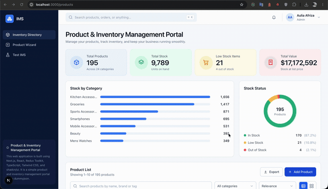

| Dashboard and inventory table                   | Search and category filter (URL synced)                         |
| ----------------------------------------------- | --------------------------------------------------------------- |
| 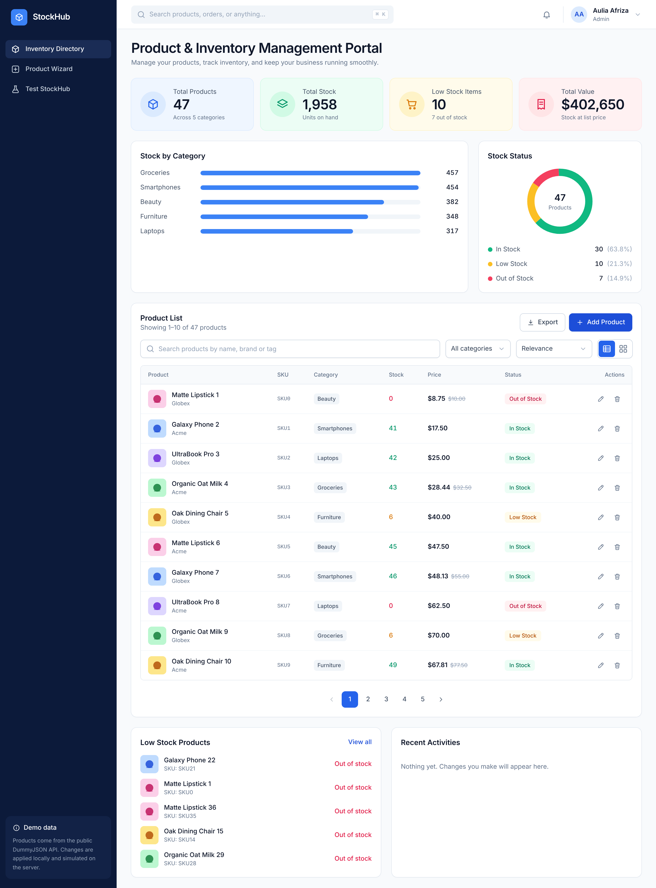 | 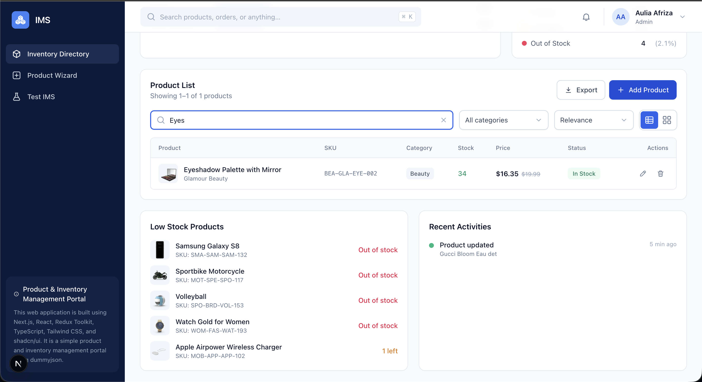 |

| Card view                                       | Empty state                                         |
| ----------------------------------------------- | --------------------------------------------------- |
| 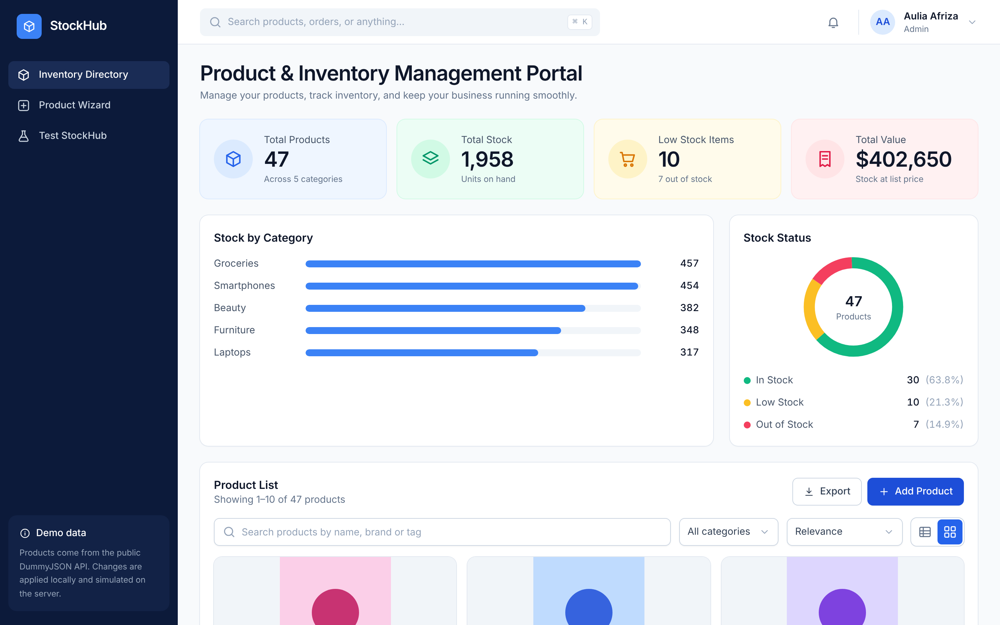 | 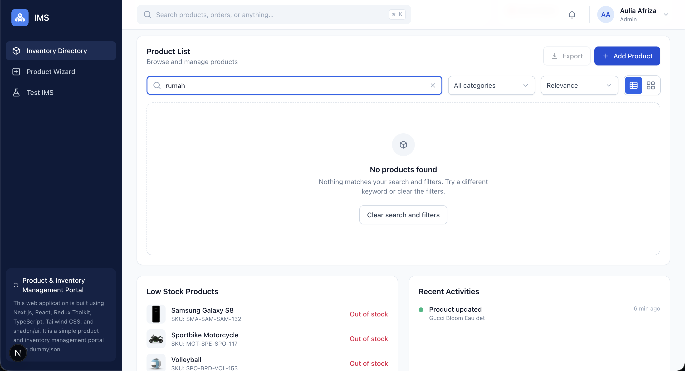 |

| Optimistic delete in flight                                              | Rollback with Retry toast                                            |
| ------------------------------------------------------------------------ | -------------------------------------------------------------------- |
| 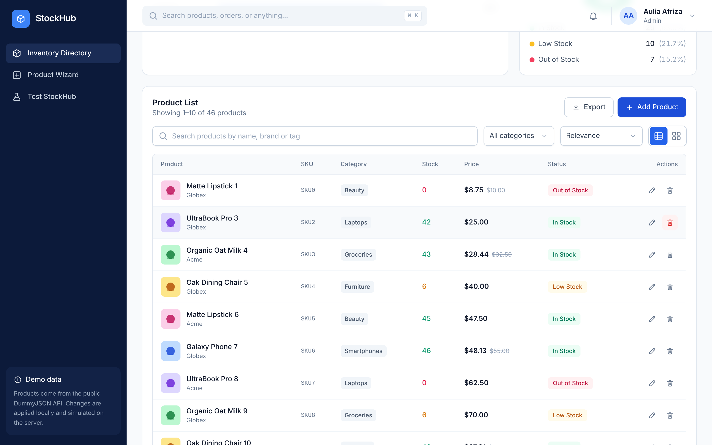 | 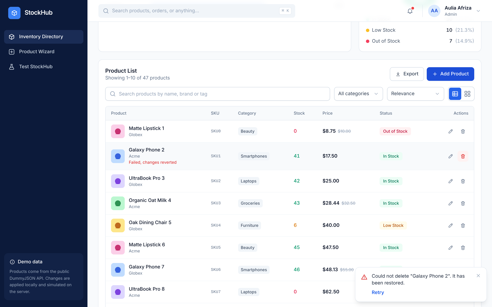 |

| Wizard validation                                               | Pricing and SKU variations                                       |
| --------------------------------------------------------------- | ---------------------------------------------------------------- |
| 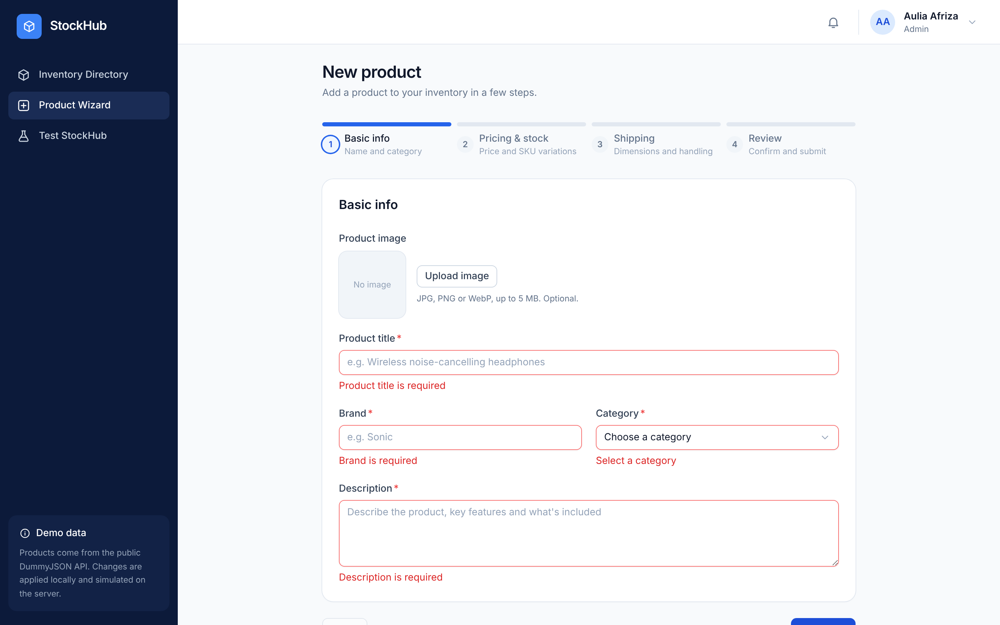 | 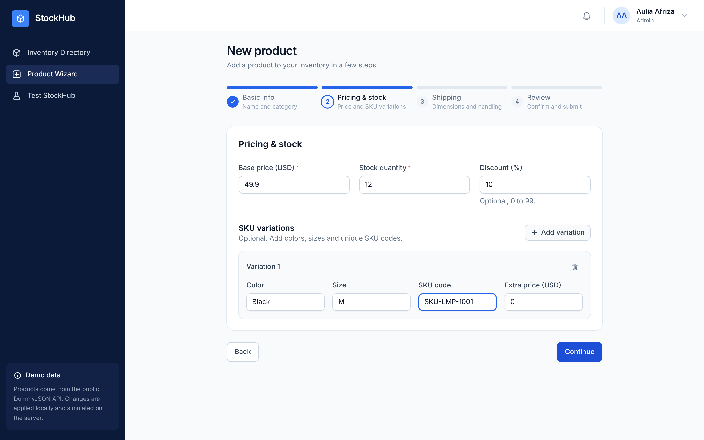 |

| Conditional shipping fields                                      | Review with product preview                              |
| ---------------------------------------------------------------- | -------------------------------------------------------- |
| 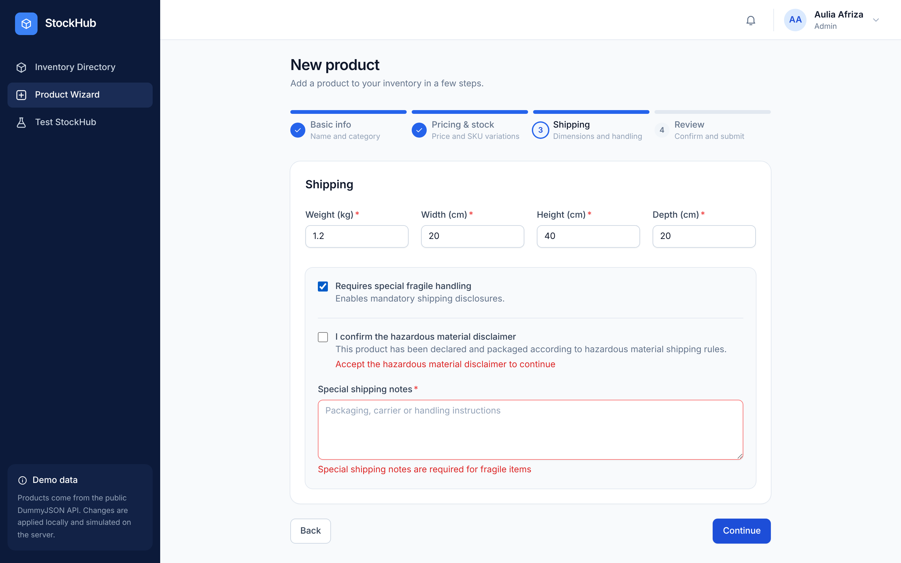 | 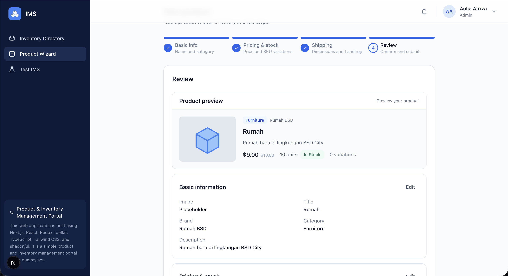 |

| Product created                                    | List refetching after create                           |
| -------------------------------------------------- | ------------------------------------------------------ |
| 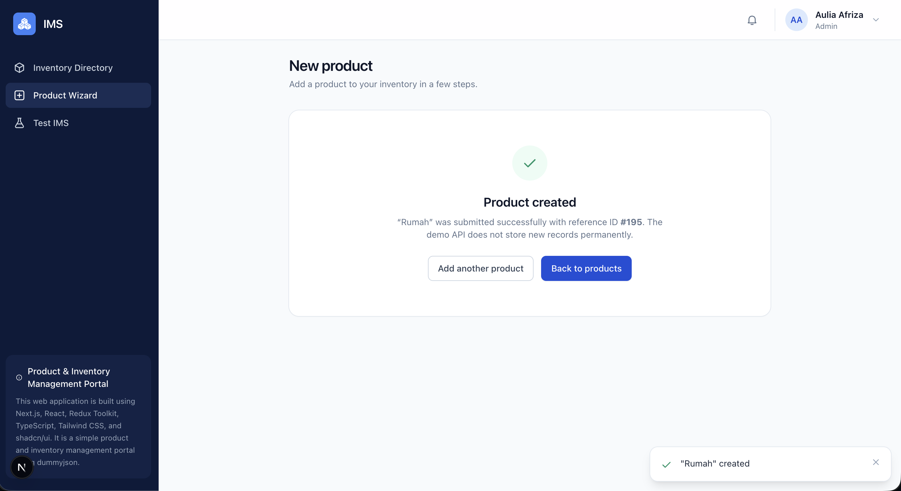 | 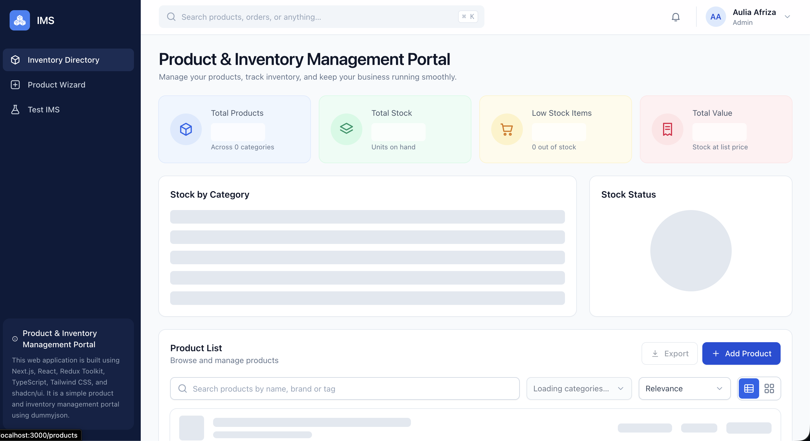 |

| New product in the list                                  | Resume saved draft prompt                                    |
| -------------------------------------------------------- | ------------------------------------------------------------ |
| 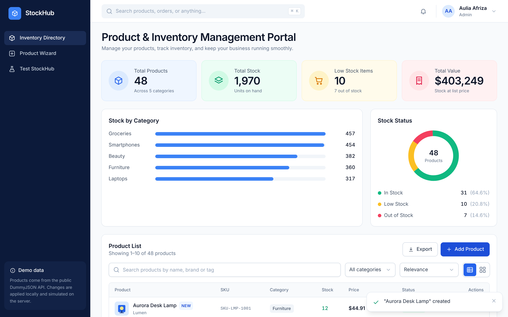 | 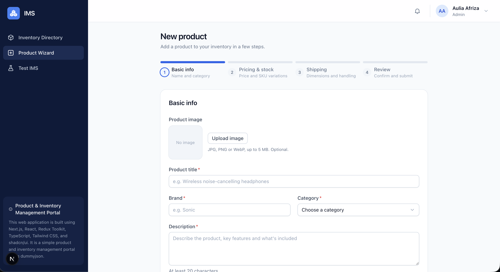 |

| Test StockHub page                                      | Mobile list and filter drawer                                                                                  |
| ------------------------------------------------------- | -------------------------------------------------------------------------------------------------------------- |
| 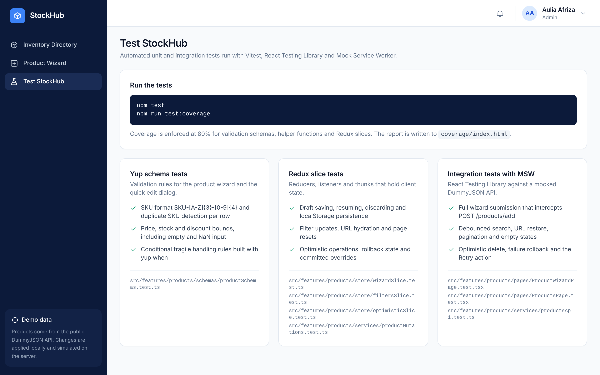 | 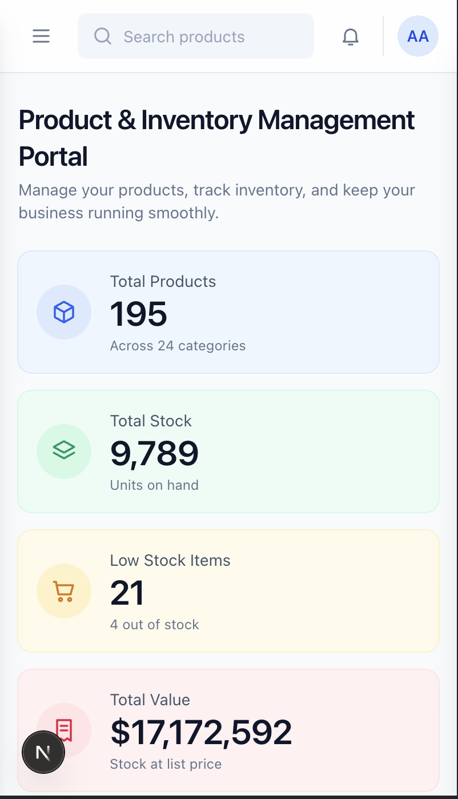 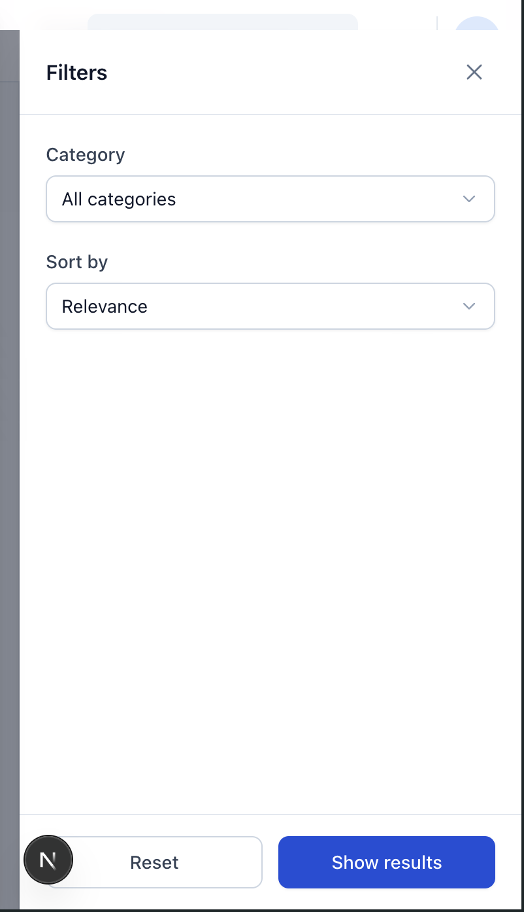 |

## Stack

| Area       | Choice                                                                      |
| ---------- | --------------------------------------------------------------------------- |
| Framework  | Next.js 15 (App Router), React 19                                           |
| Language   | TypeScript with `strict` and `noImplicitAny`, no `any` (enforced by ESLint) |
| State      | Redux Toolkit (`createSlice`, `createAsyncThunk`, listener middleware)      |
| API layer  | RTK Query with optimistic updates, rollback and cache tuning                |
| Forms      | React Hook Form, Yup, `@hookform/resolvers/yup`                             |
| Styling    | Tailwind CSS only, every component is hand written                          |
| Testing    | Vitest, React Testing Library, MSW                                          |
| Deployment | Vercel                                                                      |

## Local setup

Requirements: Node.js 20 or newer (verified on Node 22 and 25) and npm.

```bash
npm install
cp .env.example .env.local
npm run dev
```

Open http://localhost:3000. The app redirects to `/products`.

| Command                 | What it does                                              |
| ----------------------- | --------------------------------------------------------- |
| `npm install`           | Installs dependencies (`.npmrc` sets `legacy-peer-deps`)  |
| `npm run dev`           | Starts the development server on port 3000                |
| `npm run test`          | Runs the whole ViTest StockHub once                          |
| `npm run test:coverage` | Runs the suite with coverage and enforces the 80% minimum |
| `npm run build`         | Creates the production build                              |
| `npm run start`         | Serves the production build                               |
| `npm run lint`          | Runs ESLint                                               |
| `npm run type:check`    | Runs the TypeScript compiler without emitting files       |

`yarn` works the same way (`yarn install`, `yarn dev`, `yarn test`, `yarn build`).

Environment variables:

| Variable                   | Default                 | Purpose                                                  |
| -------------------------- | ----------------------- | -------------------------------------------------------- |
| `NEXT_PUBLIC_API_BASE_URL` | `https://dummyjson.com` | API origin                                               |
| `NEXT_PUBLIC_FAILURE_RATE` | `0.2`                   | Chance (0 to 1) that a delete or update fails on purpose |

Set `NEXT_PUBLIC_FAILURE_RATE=1` to watch every delete or update roll back, or `0` to disable the simulated failures.

## Features

### App shell and dashboard

- Dark sidebar with the three feature areas (Inventory Directory, Product Wizard, Test StockHub), a top bar with global
  search (press Cmd/Ctrl + K) and a mobile navigation drawer.
- `/products` opens with summary cards, a stock-by-category chart, a stock status donut, low stock products and a recent
  activity feed. All figures are computed from the API data and update instantly when a product is edited or deleted.
- `/testing` documents the automated Test StockHubs and how to run them.

### Inventory directory (`/products`)

- Server-driven pagination (10 per page), debounced search, category filter populated from the API, and sorting.
- Search, category, sort and page are mirrored in the URL (`/products?search=phone&category=smartphones&sort=price_desc&page=2`).
  Reloading or sharing the link restores the exact view, and the browser back and forward buttons work.
- Table and card layouts, CSV export of the current page, skeleton loading, empty and error states, and a slide-out
  filter drawer on small screens.
- Delete and edit update the list immediately. About 20% of these requests fail on purpose; the change is rolled back
  and an error toast offers a Retry action.
- A product detail page at `/products/[id]`.

### Product wizard (`/products/new`)

- Step 1 basic info, step 2 pricing and dynamic SKU variations, step 3 shipping, step 4 review with Edit shortcuts.
- Yup rules include the `SKU-[A-Z]{3}-[0-9]{4}` format, duplicate SKU detection across the field array, a discount range
  of 0 to 99, and conditional `yup.when` rules for fragile items (disclaimer and notes become mandatory).
- Progress is autosaved to Redux and `localStorage`. After a refresh the user is asked "Resume saved product draft?".
- The review step shows a product preview and the product is only created after the reviewer ticks the confirmation checkbox and presses "Create product".
- After creation the new product is stored locally (the demo API does not persist writes), the `Inventory` cache tag is invalidated, and the list and dashboard summary refetch with a simulated delay when the user returns to `/products`. New items carry a "New" badge.
- Submission posts to `https://dummyjson.com/products/add`.

## Project structure

```
src/
  app/                    Routing shells only (layouts, pages, error boundaries)
  api/                    Base query shared by RTK Query endpoints
  components/ui/          Tailwind primitives: Button, fields, Modal, Drawer, Toaster, Pagination, Skeleton
  components/layout/      App shell: sidebar, top bar, mobile navigation
  features/products/
    pages/                Page components rendered by app/
    components/           Table, cards, filters, edit dialog, wizard steps
    hooks/                URL and Redux synchronisation
    schemas/              Yup schemas
    services/             RTK Query endpoints and mutations
    store/                Slices (filters, optimistic operations, toasts, activity, wizard draft)
    utils/                URL parsing, request building, payload mapping
  hooks/, lib/, store/    Shared hooks, helpers, store setup
  test/                   MSW handlers, fixtures, render helpers
```

## Testing

```bash
npm test
npm run test:coverage
```

- Schema tests cover SKU format, duplicate SKUs, price, stock and discount bounds, and the fragile handling rules.
- Slice tests cover filters, optimistic operations and rollback, toasts and draft persistence.
- Integration tests use React Testing Library with MSW. They walk the whole wizard through to the
  `POST /products/add` request, and exercise search, URL restore, optimistic delete, failure rollback and retry.
- Coverage is enforced at 80% for schemas, slices and helpers; the current run is above 95%.

## Deploying to Vercel

URL VERCEL : https://inventory-management-portal-silk.vercel.app/products
ENV all setup in vercel

## Technical rationale

### Race condition handling

Typing is split in two. The input keeps its own value so it never lags, and a 300 ms debounce commits the trimmed
value to Redux. Rapid keystrokes therefore produce a single request, not one per character.

Responses that arrive late or out of order cannot overwrite what is on screen, because RTK Query stores each argument
set (search, category, sort and page) under its own cache key and the page reads only the entry for the current
arguments (`currentData`). A slow response for an older query lands in its own entry, which is also what makes going
back to a previous search instant. While the current entry has no data yet, the page shows a skeleton instead of the
previous results. Superseded requests are not aborted; they finish and are cached, then evicted after the unused-data
timeout.

The URL has the same protection. Every URL the app writes is remembered until the router reports it back, so a delayed
echo of an older URL is ignored instead of replacing newer state, and the input only adopts a value from Redux when it
did not emit that value itself, so the user's typing is never overwritten.

### State distribution boundaries

- **RTK Query cache** owns server data: product pages, categories and single products. It handles caching,
  deduplication and request status, so none of that is hand written.
- **Redux slices** own client state that has to outlive a component or be shared: the committed filters (kept in sync
  with the URL), the view mode, toast notifications, per-product optimistic operation status, products created in the wizard (the demo API does not persist writes), and the
  wizard draft.
  Everything in them is serializable, which is why toasts carry a retry descriptor and not a callback.
- **React Hook Form** owns the values while the user is typing. Inputs are uncontrolled, so a keystroke does not
  re-render the wizard or write to the store. Only a debounced snapshot is copied into Redux for draft persistence, and
  Yup is the single source of validation rules. The optional product image lives in the form as a downscaled data URL.

Keeping these apart avoids storing the same data twice: the hand-written slices never hold API responses, the form never holds committed
filters, and the URL is treated as an input that is parsed into Redux and a mirror of it, not a third copy to reconcile
by hand.

### Re-render optimisation in the SKU field array

- Rows are keyed by the stable `field.id` from `useFieldArray`, so removing or adding a row does not remount the others.
- Each row is wrapped in `React.memo` and receives only `index`, `control`, `register` and a stable `remove`
  callback, so a row re-renders only when its own index changes.
- Inputs are registered uncontrolled with `register`, which avoids a render per keystroke.
- Errors are read with `useFormState({ control, name: "variations.<index>" })` inside the row. A validation message on
  one row does not re-render its siblings or the step, and no component subscribes to the whole `formState.errors`.
- The conditional shipping fields use `useWatch` on a single field name instead of `watch()` on the whole form, and
  the draft autosave uses the `watch` callback subscription, which does not render at all.
- Step components mount only when visible, and values survive navigation because the form instance lives in the page.

### Resilience strategy

Delete and update are RTK Query mutations that use `onQueryStarted`:

1. Mark the operation as pending in the `optimistic` slice.
2. Patch every cached product list with `updateQueryData`, which returns a `PatchCollection` for each entry.
3. Await the request. On success, commit the change to the slice, so refetched lists still honour it, and show a success toast.
4. On failure, call `undo()` on every patch, which restores the exact previous cache state, mark the operation as
   `failed`, and show an error toast carrying a serializable retry descriptor. Retry simply dispatches the same mutation
   again.

A created product is committed to the `optimistic` slice only after the POST succeeds, and then the `Inventory` cache tag
is invalidated so the list and dashboard summary refetch. Create failures never touch the cache.

The 20% failure is injected inside the mutation, after a short artificial delay, so the optimistic state is visible
before the rollback. The rate comes from `NEXT_PUBLIC_FAILURE_RATE`, and the random source is injectable, which keeps
the behaviour deterministic in tests.
